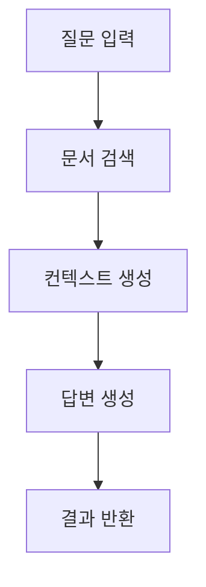
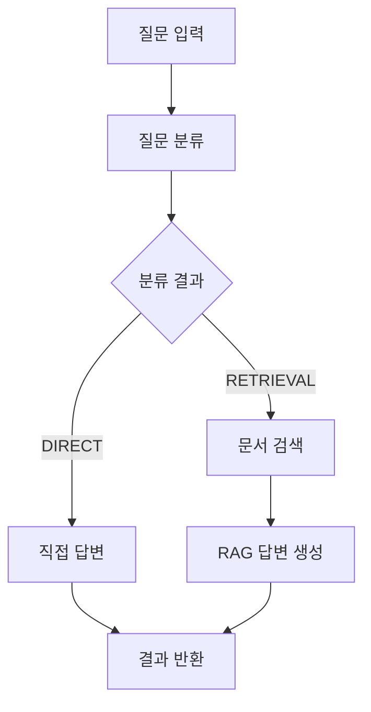

# LangGraph RAG 시스템

LangGraph를 사용하여 구현한 고급 RAG(Retrieval-Augmented Generation) 시스템입니다. 이 시스템은 문서 검색과 AI 생성을 결합하여 정확하고 맥락에 맞는 답변을 제공합니다.

## 🚀 주요 기능

### 1. LangGraph 워크플로우
- **StateGraph 기반 파이프라인**: 문서 검색과 답변 생성을 단계적으로 처리
- **조건부 라우팅**: 질문 유형에 따라 다른 처리 경로 선택
- **향상된 워크플로우**: 질문 분류를 통한 효율적인 처리

### 2. 벡터 검색
- **ChromaDB 통합**: 고성능 벡터 데이터베이스
- **OpenAI 임베딩**: text-embedding-3-small 모델 사용
- **유사도 검색**: 관련 문서를 점수와 함께 검색

### 3. 다양한 문서 형식 지원
- **PDF 파일**: PyPDF를 통한 PDF 문서 처리
- **텍스트 파일**: 일반 텍스트 파일 지원
- **직접 텍스트 입력**: API를 통한 텍스트 직접 업로드

### 4. 지능형 질문 분류
- **자동 분류**: RETRIEVAL vs DIRECT 질문 구분
- **효율적 처리**: 검색이 필요 없는 질문은 직접 답변
- **한국어 지원**: 한국어 질문과 답변 완벽 지원

## 📋 시스템 구조

```
backend/
├── main.py              # FastAPI 메인 애플리케이션
├── config.py            # 환경 설정 관리
├── vector_store.py      # 벡터 스토어 관리
├── rag_workflow.py      # LangGraph RAG 워크플로우
├── example_usage.py     # 사용 예제
├── requirements.txt     # Python 의존성
├── .env.example         # 환경 변수 예제
└── README.md           # 이 문서
```

## 🛠️ 설치 및 설정

### 1. 의존성 설치

```bash
cd backend
pip install -r requirements.txt
```

### 2. 환경 변수 설정

`.env` 파일을 생성하고 다음 내용을 추가하세요:

```bash
# OpenAI API 키 (필수)
OPENAI_API_KEY=your_openai_api_key_here

# LangChain 추적 (선택사항)
LANGCHAIN_TRACING_V2=true
LANGCHAIN_API_KEY=your_langchain_api_key_here
LANGCHAIN_PROJECT=rag-langgraph

# 벡터 스토어 설정
CHROMA_PERSIST_DIRECTORY=./chroma_db
CHUNK_SIZE=1000
CHUNK_OVERLAP=200
```

### 3. 서버 실행

```bash
uvicorn main:app --reload --host 0.0.0.0 --port 8000
```

서버가 실행되면 다음 URL에서 확인할 수 있습니다:
- API 문서: http://localhost:8000/docs
- 시스템 정보: http://localhost:8000/info

## 📚 API 사용법

### 1. 문서 업로드

#### 파일 업로드
```bash
curl -X POST "http://localhost:8000/upload/file" \
  -H "Content-Type: multipart/form-data" \
  -F "file=@your_document.pdf"
```

#### 텍스트 직접 업로드
```bash
curl -X POST "http://localhost:8000/upload/text" \
  -H "Content-Type: application/json" \
  -d '{
    "text": "여기에 문서 내용을 입력하세요",
    "metadata": {"source": "manual_input", "type": "note"}
  }'
```

### 2. 질의응답

```bash
curl -X POST "http://localhost:8000/query" \
  -H "Content-Type: application/json" \
  -d '{
    "question": "LangGraph가 무엇인가요?",
    "use_enhanced": true
  }'
```

### 3. 문서 검색

```bash
curl "http://localhost:8000/search/머신러닝?k=3"
```

### 4. 시스템 상태 확인

```bash
curl "http://localhost:8000/health"
```

## 💻 프로그래밍 방식 사용

### 기본 사용법

```python
from vector_store import vector_store_manager
from rag_workflow import rag_workflow, enhanced_rag_workflow

# 1. 문서 추가
doc_id = vector_store_manager.add_text(
    "여기에 문서 내용", 
    {"source": "example"}
)

# 2. 기본 RAG 쿼리
result = rag_workflow.run_rag("질문을 입력하세요")
print(result['answer'])

# 3. 향상된 RAG 쿼리 (질문 분류 포함)
enhanced_result = enhanced_rag_workflow.run_rag("질문을 입력하세요")
print(f"분류: {enhanced_result['classification']}")
print(f"답변: {enhanced_result['answer']}")
```

### 예제 실행

```bash
python example_usage.py
```

## 🔧 고급 설정

### 워크플로우 커스터마이징

`rag_workflow.py`에서 다음을 수정할 수 있습니다:

- **프롬프트 템플릿**: 시스템 메시지와 답변 형식
- **검색 파라미터**: 검색할 문서 개수 (k값)
- **모델 설정**: LLM 모델과 온도 설정
- **라우팅 로직**: 질문 분류 기준

### 벡터 스토어 설정

`config.py`에서 다음을 조정할 수 있습니다:

- **청크 크기**: 문서 분할 단위
- **청크 오버랩**: 청크 간 중복 범위
- **임베딩 모델**: OpenAI 임베딩 모델 선택

## 🎯 워크플로우 상세

### 1. 기본 RAG 워크플로우



### 2. 향상된 RAG 워크플로우



## 📊 성능 최적화

### 1. 벡터 검색 최적화
- 청크 크기 조정으로 검색 정확도 향상
- 임베딩 모델 선택으로 의미적 유사도 개선

### 2. 질문 분류 최적화
- 불필요한 검색 과정 제거
- 응답 속도 향상

### 3. 메모리 관리
- ChromaDB 영구 저장으로 재시작 시 데이터 유지
- 배치 처리로 대용량 문서 효율적 처리

## 🔍 트러블슈팅

### 일반적인 문제들

1. **OpenAI API 키 오류**
   ```
   해결: .env 파일에 올바른 API 키 설정
   ```

2. **ChromaDB 초기화 실패**
   ```bash
   # 벡터 스토어 초기화
   curl -X DELETE "http://localhost:8000/vector-store"
   ```

3. **메모리 부족**
   ```
   해결: 청크 크기 줄이기 또는 배치 크기 조정
   ```

4. **의존성 설치 오류**
   ```bash
   pip install --upgrade pip
   pip install -r requirements.txt --force-reinstall
   ```

## 🌟 확장 가능성

### 1. 추가 가능한 기능
- **다중 언어 지원**: 여러 언어의 문서와 질의 처리
- **파일 형식 확장**: Word, Excel, PowerPoint 등
- **실시간 스트리밍**: WebSocket을 통한 실시간 응답
- **사용자 관리**: 개인별 문서 관리 시스템

### 2. 성능 향상
- **GPU 가속**: CUDA 지원으로 임베딩 속도 향상
- **분산 처리**: 여러 서버에 워크로드 분산
- **캐싱 시스템**: Redis를 통한 질의 결과 캐싱

### 3. 모니터링
- **LangSmith 통합**: 워크플로우 실행 추적
- **메트릭 수집**: 응답 시간, 정확도 측정
- **로그 분석**: 시스템 성능 분석

## 📝 라이선스

이 프로젝트는 MIT 라이선스 하에 배포됩니다.

## 🤝 기여하기

1. 이 저장소를 포크하세요
2. 새로운 기능 브랜치를 생성하세요 (`git checkout -b feature/new-feature`)
3. 변경사항을 커밋하세요 (`git commit -am 'Add new feature'`)
4. 브랜치에 푸시하세요 (`git push origin feature/new-feature`)
5. Pull Request를 생성하세요

## 📞 지원

문제가 있거나 질문이 있으시면 이슈를 생성해 주세요.

---

**LangGraph RAG 시스템으로 더 나은 AI 문서 처리를 경험해보세요! 🚀**